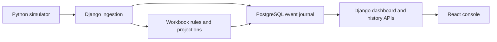

# Astronaut Health Monitoring System

**NASA Space Apps Challenge 2026 — Prototype | November 14–15, 2026**  
**Working project name:** Astronaut Health Monitoring System (branding TBD; *AstroPulse* is one candidate)

> **Project status:** Architecture and implementation plan. This README describes the system we intend to build, **not** a finished or deployed application.  
> **Safety notice:** This is a hackathon prototype using simulated data. It is **not a medical device**, and the thresholds, alerts, scoring adaptations, and guidance must not be treated as operational medical advice for astronauts.

**Implemented components:** the [Django operational models and ingestion API](backend/README.md#simulator-ingestion-api) and the standalone [Python astronaut and cabin simulator](simulator/README.md) supports preflight profiles, historical backfill, live streaming, solar storms, durable checkpoints, and configurable HTTP delivery. See its README for commands and contracts.

**Connected frontend:** the [React console](frontend/README.md) reads actual ingested crew/cabin values and recorded trends through [Django operational read APIs](backend/README.md#connected-frontend-read-apis). Telemetry is still synthetic simulator output; workbook-based prototype alerts are connected; authenticated UI check-ins are connected; forecasts remain pending.

## 1. Mission and vision

Build an **offline-first, astronaut-facing health monitoring application** that helps a crew member:

- View current health measurements and trends in an understandable visual interface.
- Compare observations with **personal preflight and in-flight baselines**, not just generic Earth reference ranges.
- Understand potential connections between **cabin/environmental conditions** and health symptoms.
- Receive clear, on-board **alerts and predefined next-step guidance** when appropriate.
- Record measurements, check-ins, and actions for later review, even when Earth communication is delayed or unavailable.

The challenge briefing identifies **six must-have indicators**: blood pressure, heart rate, blood sugar, body temperature, sleep hours, and mood. It also proposes an interactive body map, habitat indicators, trend charts, guided measurements, routine tasks, and different mission environments.

### Why the problem matters

Space missions expose crews to radiation, isolation, delayed communication with Earth, altered gravity, and closed-cabin environmental hazards. A crew cannot always wait for support from Earth. The prototype therefore emphasizes *personal context, environmental context, local operation, and clear human-facing explanations*.

### Product principles

1. **Astronaut first:** simple explanations, accessible alerts, and actionable checklists; do not assume medical expertise.
2. **Baseline first:** compare each astronaut against their own history before presenting generic thresholds.
3. **Cabin before conclusion:** examine environmental conditions alongside unusual physiological observations; correlation is not a diagnosis.
4. **Onboard response:** live alerting must not depend on historical aggregation refreshes or an Earth-hosted service.
5. **Provenance matters:** visibly label all simulated measurements and distinguish confirmed source values from team-proposed rules.

---

## 2. Technology stack

| Component | Technology | Responsibility |
|---|---|---|
| Simulator | Standalone Python | Synthetic telemetry, scenarios, durable local replay journal |
| Backend | Django | Authenticated ingestion, validation, rules and read APIs |
| Application storage | PostgreSQL | All accepted events, original JSON payloads, baselines, latest readings, alerts and assessments |
| Frontend | React + Three.js | Crew and habitat views, body map, recorded trend charts |
| Local deployment | Docker Compose | PostgreSQL, Django and simulator services |

## 3. System architecture



PostgreSQL is the sole application event store for normal and abnormal telemetry.
Ingestion commits the raw journal, latest values, supplementary facts and alert
updates atomically before acknowledging delivery. Historical charts aggregate the
same database journal, with no separate export process or eventual-consistency gap.
The simulator's SQLite checkpoint remains a local generation/retry buffer, not a
second application analytics store. Existing event IDs make delivery retries safe.

---

## 4. Data domains

There are **two principal measurement domains**. Mission/context metadata connects them.

### Domain A — Astronaut data

#### A1. Preflight baseline (imported in batch)

Personal reference measurements available before departure, such as:

- Resting heart rate and blood pressure.
- Fasting glucose, resting temperature, sleep patterns, and mood baseline where available.
- Fitness, strength, and other applicable pre-mission assessments.

This baseline is **per astronaut**, may use different observation windows, and should retain measurement dates, units, source, and quality notes. Do not generate a false baseline when no reference is available; show **insufficient baseline data** instead.

#### A2. In-flight observations (stream, spot checks, batch summaries)

- **Stream:** heart rate; optionally breathing rate, activity, skin temperature, or individual radiation dosimetry.
- **Spot-check or manual input:** blood pressure, glucose (with **fasting/after-meal tag**), body temperature, symptoms.
- **Nightly/daily:** sleep duration, mood score, exercise or workload logs.
- **Event context:** rest, sleep, exercise, spacewalk, current mission phase.

### Domain B — Cabin / habitat data

Synthetic environmental measurements associated with a habitat or cabin zone, not inherently with an astronaut:

- CO2 (units and averaging window matter).
- Oxygen **partial pressure** (not interchangeable with oxygen concentration `%`).
- Total atmospheric pressure.
- Cabin temperature and humidity.
- Radiation dose rate / cumulative dose, where available.
- Noise and dust, if implemented.

### Shared mission context

Measurements can be joined through `mission_id`, `habitat_id` / `zone_id`, timestamps, and (for astronaut data) `astronaut_id`. Relevant metadata includes:

- Mission phase: preflight, transit, station, surface, rover/EVA, etc.
- Environment type: spacecraft, station, rover, surface base.
- Activity and measurement conditions.
- Simulator scenario, device/source ID, and signal quality.

**Key idea:** a headache report near a cabin CO2 rise may justify showing environmental context and a predefined checklist. It does **not** prove the cabin caused the symptom.

---

## 5. Ingestion strategy — stream **and** batch

These are **demo sampling/cadence decisions**, not claimed NASA sensor specifications.

| Measurement/source | Proposed mode | Suggested demo cadence |
|---|---|---|
| Preflight baseline file | Batch import | Once per astronaut/setup |
| Astronaut heart rate | Synthetic stream | Every 2–5 seconds |
| Cabin CO2 / O2 / pressure | Synthetic stream | Every 2–5 seconds |
| Cabin/personal radiation | Synthetic stream | Around every 5 seconds |
| Blood pressure | Simulated or manual spot check | On demand |
| Glucose | Simulated or manual spot check | On demand; include meal context |
| Body temperature | Simulated or manual spot check | On demand |
| Sleep | Synthetic batch summary or manual | Once per simulated night |
| Mood | Manual daily check-in | Once per simulated day |
| Historical trends | PostgreSQL aggregation | Queried from recorded observations |

Keep **event time** (when the measurement occurred) distinct from **ingestion time** (when Django received it). Simulated time should be visibly identified in demo/replay mode.

### Proposed canonical event envelope

```json
{
  "event_id": "evt-000001",
  "mission_id": "MARS_001",
  "astronaut_id": "AST_001",
  "habitat_id": "HAB_001",
  "zone_id": "CABIN_MAIN",
  "metric": "heart_rate",
  "value": 78,
  "unit": "bpm",
  "measured_at": "2026-11-14T10:30:00Z",
  "activity": "rest",
  "source": "smart_garment_simulator",
  "simulated": true,
  "scenario_id": "nominal"
}
```

For a cabin event, use `astronaut_id: null`, retain `habitat_id` / `zone_id`, and specify a cabin metric such as `co2_partial_pressure` in `mmHg`. Real records will require schema/version validation, metric-specific units, and authorization rules. This JSON is a **proposed contract**, not an implemented endpoint.

---

## 6. PostgreSQL history and provenance

`measurement_events` retains every accepted event and its original `raw_payload`.
Canonical metric identifiers, typed values, timestamps, source, activity and habitat
context support validation, replay, baseline comparisons, time-weighted exposure
windows and historical trends. `/api/v1/trends` queries this journal directly.

## 7. PostgreSQL model

| Tables | Purpose |
|---|---|
| `missions`, `habitats`, `astronauts`, `mission_crew`, `simulation_runs` | Mission identity and context |
| `metric_catalog` | Canonical units, domains and aggregation semantics |
| `measurement_events` | Complete immutable accepted event journal, including original JSON |
| `preflight_profiles`, `preflight_baselines` | Personal reference observations |
| `latest_measurements`, `latest_rule_inputs` | Current measurements and independently retained supplementary facts |
| `monitoring_alerts`, `alert_assessments` | Alert lifecycle, acknowledgment, evidence and rule coverage |

## 8. Django APIs

```text
POST /api/v1/ingest/events                 # bearer-authenticated synthetic event ingestion
GET  /api/v1/dashboard                     # latest state, baselines, coverage and alerts
GET  /api/v1/trends                        # recorded PostgreSQL history
GET  /api/v1/alerts                        # active alerts and evidence
GET  /api/v1/alert-rules                   # workbook specification and evaluation notes
POST /api/v1/alerts/{id}/acknowledge        # CSRF-protected review acknowledgment
```

See [backend documentation](backend/README.md) for request contracts and query
parameters. Authenticated crew check-ins persist manual measurements, findings, and
notes through `/api/v1/check-ins`; `/api/v1/session` provides session login.

---

## 9. Alerts and health interpretation

A rules engine evaluates each relevant incoming event promptly, ideally after basic validation and with astronaut activity and habitat context available. Alerts and their historical context live in PostgreSQL.

**Proposed evaluation flow:**

1. Receive and validate the event (metric, unit, entity, timestamp, source quality).
2. Determine astronaut baseline and activity or cabin zone context.
3. Apply an appropriate, documented rule (including required rolling windows).
4. Inspect relevant environmental observations where useful.
5. Create/update/rescind alert state idempotently, storing the evidence used.
6. Show a concise explanation, measurement timestamp, and a clearly labeled predefined response checklist.

**Important clinical limitations:** The challenge briefing discusses NEWS2 and astronaut-specific modifications, but says NEWS2 was developed for terrestrial hospital patients and the proposed space modifications are **untested**. Do not label an assessment as validated NEWS2 unless all required measurements and scoring rules are actually implemented, and do not convert this hackathon's proposed thresholds into clinical decisions. Differentiate **NASA-source limits**, **other cited reference ranges**, and **team-proposed prototype heuristics**.

### Target demonstration scenario: rising cabin CO2

1. Start with nominal synthetic astronaut and cabin observations.
2. Trigger a simulator scenario where cabin CO2 increases gradually.
3. Show the cabin trend and a rule-driven alert in React.
4. Have an astronaut log a headache via the body map/check-in.
5. Display relevant time-aligned environmental and personal observations, with wording such as **“possible environmental contributor”**.
6. Show a predefined onboard checklist and allow an acknowledgment/action log.
7. Demonstrate that events appear in both current readings and recorded PostgreSQL history.

This single scenario demonstrates the value of two data domains, both storage paths, contextual monitoring, and an astronaut-friendly interface.

---

## 10. React application — planned screens

**MVP priority**

- **Mission dashboard:** crew, environment, overall status, current alerts.
- **Astronaut view:** six required indicators, latest values, personal baseline comparison, trends and manual entry.
- **Cabin dashboard:** CO2, oxygen partial pressure, pressure, temperature, radiation (and other sensors if time permits).
- **Alerts and incident view:** severity, contributing observations, timestamps, checklist and acknowledgment.
- **Interactive body map:** selected health regions plus a cabin/habitat ring.
- **History:** 24-hour / 7-day / 30-day charts from PostgreSQL where data exists.

**Stretch goals**

- Twelve fully developed body regions; reaction-time tests; gamified daily flight plan; environment switching (spacecraft/station/rover/base); richer wearables and sensor catalog; guided measurement workflow; uploadable image-based check-ins.

### Offline-first design

The intended deployment is **onboard/local**: Django and PostgreSQL run on infrastructure reachable within the crew's local network, not on Earth. A React PWA can cache the app shell and essential guidance and queue permitted manual inputs in browser storage if briefly disconnected from the local backend. It **cannot** continue to receive live sensor updates or reliably issue shared alerts when the local server is unavailable unless additional local processing is implemented. This distinction must be demonstrated honestly.

---

## 11. Repository layout

```text
bioorbit/
├── docker-compose.yaml
├── backend/bitorbit/                  # Django application, migrations and tests
├── simulator/                        # generator, schemas, examples and tests
├── frontend/                         # React console
└── docs/                             # design and review notes
```

From the repository root, configure `.env` using `.env.example`, then run
`docker compose up --build`. The frontend runs separately with the commands in
[frontend/README.md](frontend/README.md). Back up the PostgreSQL database; named
volumes survive an ordinary `docker compose down`.

---

## 12. Two-day implementation roadmap

### Day 1 — November 14: establish end-to-end data flow

- [ ] Confirm event schema, units, IDs, baseline representation, and scenario requirements.
- [ ] Scaffold simulator, Django API, PostgreSQL, and React.
- [ ] Generate synthetic astronaut and cabin readings with nominal and abnormal scenarios.
- [ ] Implement ingestion, event idempotency, latest state, and an initial alert rule.
- [x] Persist original payloads and history in PostgreSQL.
- [x] Expose dashboard and historical trend endpoints backed by PostgreSQL.
- [ ] Display the six mandatory astronaut indicators (entry, status, chart, guidance), at least in a minimal interface.

### Day 2 — November 15: complete astronaut experience and demo

- [ ] Implement the interactive body map and habitat overview.
- [ ] Complete cabin alerts, acknowledgment, and check-ins.
- [ ] Connect personal baselines, historical charts, and environmental context.
- [ ] Add basic offline caching and clearly mark simulated data.
- [ ] Run the CO2 + headache end-to-end scenario and failure/retry tests.
- [ ] Polish presentation, scientific caveats, evidence, and judging pitch.

### Definition of a successful MVP

- Simulator sends synthetic data to Django.
- All accepted events are durably stored in PostgreSQL without duplicate effects on retry.
- Database queries build historical trends from recorded events.
- React displays current values and historical trends from PostgreSQL.
- Cabin context and an astronaut symptom can be inspected together.
- At least one alert is triggered, explained, and acknowledged.
- The six required indicators have an end-to-end path (including manually entered or daily summary indicators).
- The interface and pitch explicitly say the data are simulated and the rules are a prototype.

---

## 13. Risks and engineering decisions

| Risk | Mitigation |
|---|---|
| Too much infrastructure for 48 hours | PostgreSQL, one Django project, polling first |
| Alert delayed by batch refresh | Rule evaluation on ingestion transaction |
| Duplicate delivery or partial ingestion | Atomic database writes, retries, event IDs |
| Incorrect clinical interpretation | Clearly labeled simulation, documented heuristic rules, no diagnosis claims |
| Inconsistent unit handling | Per-metric schema and unit normalization during ingestion |
| Misleading comparison across space conditions | Personal baselines + activity/mission/habitat context |
| Offline-first claim overstates capability | Show what PWA cache and local backend actually support |
| Demo with insufficient history | Generate seeded synthetic past data and clearly label replayed dates |

### Open implementation decisions

- Whether to use Django polling versus SSE/WebSockets for live UI.
- PostgreSQL retention, backup and indexing strategy as history grows.
- Which cabin sensors to include beyond the minimum demonstration.
- How to represent personal baseline confidence and missing reference data.
- Which thresholds/checklists are in-scope after review of source references.
- How much of the 12-region body map can be meaningfully implemented in the hackathon.

---

## 14. Data ethics, security, and transparency

- Use **synthetic data only** during the hackathon; never pretend it is real astronaut telemetry.
- Mark all simulated values and scenario injections conspicuously.
- Separate astronaut identities/permissions from raw sensor events.
- Do not include secrets or credentials in repository files.
- Protect ingestion endpoints against untrusted or duplicate events and validate metric ranges/units.
- Explain alert uncertainty, provenance, stale readings, and missing baseline data.
- Avoid diagnostic claims, treatment prescriptions, and unsupported inferences about causation.

---

## 15. Challenge source and attribution

**Primary project brief:** `NASA Chal_Part1.pptx` — *2026 NASA Space Apps Challenge: Astronaut health monitoring app*, dated November 13, 2026 (17-slide builder's briefing supplied to the team). It describes the six required indicators, human-body visualization, environmental hazards, data-source concepts, and prototype scope.

The briefing itself cites NASA-STD-3001, NASA health/radiation resources, the Royal College of Physicians NEWS2 framework, and other research. **The presentation is our starting brief, not a substitute for independently checking primary scientific sources or obtaining clinical review.**

**Architecture/design decisions in this README** (Django, PostgreSQL, event journal, rules, API routes, sampling frequencies, repository structure, and roadmap) are **team proposals for the hackathon**, not requirements asserted by NASA.

---

## 16. Short pitch

> **A mission-aware, offline-first astronaut health companion.** Our system combines live physiological and cabin telemetry with personal health baselines and historical analytics. It detects concerning patterns locally, explains environmental context, and gives astronauts an understandable interface to monitor their wellbeing when support from Earth is delayed.

**Build a focused, demonstrable solution first; extend the indicator catalog only after the end-to-end flow is working.**
