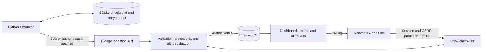

# BioOrbit — Astronaut Health Companion

**NASA Space Apps Challenge 2026 · Team Bioskopos**

We built BioOrbit to bring astronaut health measurements, personal baselines, and cabin conditions into one place. Our goal is to make changes easier to understand in the context of a mission: who the observation belongs to, what they were doing, when it was recorded, and what was happening around them.

BioOrbit is a working research prototype with a Python simulator, a Django API, PostgreSQL storage, and a React interface. Synthetic observations flow through ingestion, alert evaluation, current readings, and historical charts. Crew members can also sign in and save check-ins that feed the same measurement and alert workflow.

All simulator telemetry is synthetic. Our rules and guidance are prototype interpretations of the supplied measurement workbook and reference material. BioOrbit is not a medical device and is not affiliated with or endorsed by NASA.

## What we have built

- A mission dashboard with crew readings, personal preflight references, habitat conditions, and recorded alerts.
- An interactive Three.js astronaut with twelve selectable body regions, measurement details, and shared cabin markers.
- Body, Mind, Sleep, and Habitat measurement categories, covering the 88 configured wire metrics.
- Historical charts with 24-hour, seven-day, and thirty-day windows where applicable, exact aggregate values, and visible gaps when observations are missing.
- Four alert tiers: Advisory, Caution, Warning, and Emergency, with recorded evidence, guidance, recheck times, and acknowledgment.
- Authenticated crew check-ins for manual measurements, symptoms, findings, and notes.
- A resumable simulator with personal profiles, preflight observations, historical backfill, live generation, and configurable abnormal scenarios.
- A research landing page, biology documentation, a searchable measurement atlas, and a reference library containing 139 entries across seven categories.
- Light and dark themes shared across the public pages and console.

## Architecture



| Component | Technology | Role |
|---|---|---|
| Frontend | React, Vite, Three.js, Lucide | Research pages, crew console, interactive body view, charts, and check-ins |
| Backend | Django | Event validation, ingestion, sessions, check-ins, alert rules, and read APIs |
| Application database | PostgreSQL | Accepted events, original payloads, baselines, current state, reports, and alerts |
| Simulator | Python standard library | Seeded synthetic observations, mission time, scenarios, and HTTP delivery |
| Simulator state | SQLite | Generation checkpoints, event journal, and delivery retry state |

PostgreSQL is our single application history store. Current readings and historical charts come from the same accepted measurement journal. We do not use a separate analytics database or an export worker to populate charts.

SQLite belongs to the simulator. It preserves its clock, random generation state, observations, and delivery progress so generation and retries can resume after interruption. It is not a second dashboard data source.

## How observations move through the system

1. The simulator creates astronaut profiles, preflight observations, and in-flight astronaut and cabin measurements.
2. It records generated events in its SQLite journal and sends pending events to Django in HTTP batches using a shared ingestion token.
3. Django validates the event contracts, units, identities, and values. Stable event IDs make delivery retries idempotent.
4. Within one transaction, the backend saves accepted events and original payloads, updates current projections, and evaluates applicable alert rules.
5. New in-flight observations in a batch are evaluated in mission-time order. Measurements at the same timestamp are projected together before evaluation, preserving intermediate alert transitions.
6. The console reads the dashboard every five seconds and recorded trends every fifteen seconds. Charts aggregate accepted PostgreSQL observations.

We keep observation time, ingestion time, and wall-clock telemetry receipt age separate. This lets us inspect accelerated simulations without treating their mission timestamps as real-world sensor freshness.

## Astronaut and habitat data

We keep personal measurements separate from shared environmental observations, linked through mission, run, habitat, zone, and observation time.

**Astronaut observations** include heart rate, breathing rate, oxygen saturation, blood pressure, glucose, core temperature, sleep, mood, stress, activity, radiation exposure, and supplementary workbook measurements. Personal preflight baselines provide reference values where available.

**Habitat observations** include carbon dioxide and oxygen partial pressure, total pressure, temperature, humidity, radiation, noise, and dust. Units stay attached to each metric: oxygen partial pressure is not interchangeable with oxygen percentage.

Our catalogue represents all 83 supplied workbook indicators using 88 wire metrics. Some indicators require more than one field. Values can be numeric, boolean, categorical, or structured. Catalogue coverage does not mean every observation is available or every indicator has a validated automatic rule.

Additional independent random fixtures are labelled as such. They do not replace the contextual inputs used by the alert engine or establish physiological relationships. The generator details are documented in [expanded workbook simulation](docs/expanded-workbook-simulation.md).

## Alerts and crew reports

Our alert engine runs during ingestion and when a crew report is saved. It uses available observations, activity context, personal references, rolling windows, and explicit supplementary findings. Conditions with insufficient data stay unevaluated rather than being treated as normal.

Escalation occurs when a rule's conditions and persistence requirements are met. Recovery generally requires three distinct later qualifying normal observations to lower one tier. Repeated polling, duplicate delivery, missing inputs, and stale observations do not count as recovery. Acknowledgment records that an alert was reviewed; it does not resolve the condition.

We retain the evidence, source references, observation times, and guidance behind alerts. The interface distinguishes alert severity from overdue collection tasks and telemetry connection status. Guidance and recipient information are reference material; we do not dispatch treatments or external notifications.

Crew check-ins require a Django session, CSRF protection, and the `core.add_crewcheckin` permission. Reports retain their author and mission time. Manual readings enter the measurement journal and charts; symptoms and findings feed supported rules without manufacturing sensor samples. Notes alone do not become clinical rule inputs. Repeating the same report ID and body returns the existing report without duplicate effects.

The numerical scoring and spaceflight adaptations remain prototype rules. We do not present partial inputs as a complete validated NEWS2 assessment or infer that an environmental observation proves the cause of a symptom.

## Interface

| Route | Purpose |
|---|---|
| `/` | Research introduction, project approach, and source links |
| `/dashboard` | Crew and habitat console, body view, history, alerts, and check-ins |
| `/documentation` | Biology explanations, searchable measurement atlas, and glossary |
| `/resources` | Searchable bibliography with category filters and expandable citations |

The public pages work independently of the measurement API. The dashboard loads its code and starts polling when opened. The Three.js view loads on demand and pauses animation while the page is hidden.

We show missing values as unknown and leave missing chart buckets as gaps. When API access fails, the console can retain the last received snapshot with a connection error. It does not substitute invented readings or forecasts. Theme preference is stored in the browser.

## API

| Method | Endpoint | Purpose |
|---|---|---|
| POST | `/api/v1/ingest/events` | Bearer-authenticated simulator ingestion |
| GET | `/api/v1/dashboard` | Runs, crew, habitat readings, baselines, assessments, and alerts |
| GET | `/api/v1/trends` | Aggregated recorded measurement history |
| GET | `/api/v1/alerts` | Active alerts and evidence |
| GET | `/api/v1/alert-rules` | Workbook rule specification and evaluation notes |
| POST | `/api/v1/alerts/{id}/acknowledge` | CSRF-protected acknowledgment of the current alert tier |
| GET / POST / DELETE | `/api/v1/session` | Session status, sign-in, and sign-out |
| GET / POST | `/api/v1/check-ins` | Authorized report history and new crew reports |

The browser uses relative `/api/v1/` requests. The simulator's ingestion token stays outside browser code. Full request contracts and query parameters are in the [backend documentation](backend/README.md).

## Storage model

| Data | Tables |
|---|---|
| Mission identity and participants | `missions`, `habitats`, `astronauts`, `mission_crew`, `simulation_runs` |
| Metric definitions | `metric_catalog` |
| Accepted observations and original payloads | `measurement_events` |
| Personal preflight references | `preflight_profiles`, `preflight_baselines` |
| Current readings and supplementary facts | `latest_measurements`, `latest_rule_inputs` |
| Alert state and evaluation evidence | `monitoring_alerts`, `alert_assessments` |
| Authored crew reports | Django `CrewCheckIn` model |

Supplementary facts retain their own observation time and source. A later event that omits a finding does not erase it. Late history can contribute to current evaluation without moving current projections backward or replaying every historical alert transition.

## Repository

```text
bioorbit/
├── backend/
│   ├── bitorbit/              # Django project, APIs, models, rules, migrations, and tests
│   └── check_models.py        # Offline schema, contract, and rule checks
├── frontend/
│   ├── src/                  # React pages, console, charts, and measurement catalogue
│   └── public/               # Static assets and supplied bibliography
├── simulator/
│   ├── space_sim/            # Generator, state journal, scenarios, CLI, and HTTP delivery
│   ├── schemas/              # Event and batch contracts
│   ├── examples/             # Sample events and scenario definitions
│   └── tests/                # Simulator and delivery regression tests
└── docs/                     # Measurement audits and implementation notes
```

## Verification

We maintain regression tests for event validation, duplicate delivery, chronological batch evaluation, alert persistence and recovery, crew reports, measurement mapping, historical charts, and simulator restart behavior.

Frontend checks, from `frontend/`:

```bash
npm test
npm run build
```

Simulator checks, from `simulator/`:

```bash
python -m unittest discover -s tests
```

Offline backend checks, from the repository root with Django installed:

```bash
python backend/check_models.py
```

Database integration tests, from `backend/bitorbit/` with a configured PostgreSQL connection and test-database permissions:

```bash
python manage.py test core
```

The offline backend checks do not replace PostgreSQL integration tests. Component-specific details are in the [frontend](frontend/README.md), [backend](backend/README.md), and [simulator](simulator/README.md) documentation.

## Current limits

We have an end-to-end simulated measurement and reporting workflow, but we have not connected real wearables or spacecraft sensors. The simulator is not a validated physiological or radiation-transport model.

Forecasting, browser offline caching, and an offline check-in queue are not implemented. Live readings and shared alert evaluation require the backend. There is no independent watchdog producing new clinical alerts when ingestion stops; the interface reports telemetry inactivity and retains the last known state.

Our documentation and bibliography provide research context. Bibliography entries are preserved as supplied, rather than represented as independently verified datasets connected to the console. We keep source-derived limits, workbook conditions, and our own prototype assumptions distinguishable so the evidence and uncertainty remain visible.
