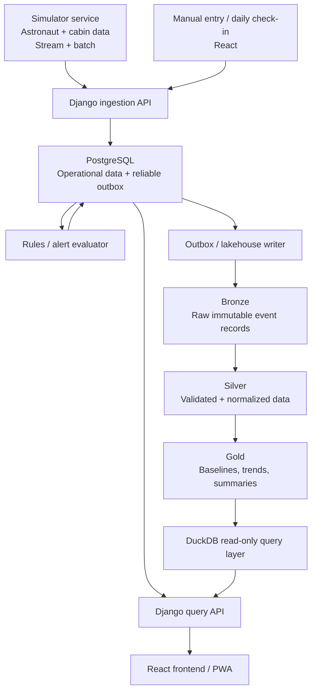

# Astronaut Health Monitoring System

**NASA Space Apps Challenge 2026 — Prototype | November 14–15, 2026**  
**Working project name:** Astronaut Health Monitoring System (branding TBD; *AstroPulse* is one candidate)

> **Project status:** Architecture and implementation plan. This README describes the system we intend to build, **not** a finished or deployed application.  
> **Safety notice:** This is a hackathon prototype using simulated data. It is **not a medical device**, and the thresholds, alerts, scoring adaptations, and guidance must not be treated as operational medical advice for astronauts.

**Implemented components:** [durable Bronze JSON export](backend/README.md#bronze-raw-json-export), the [Django operational models and ingestion API](backend/README.md#simulator-ingestion-api) and the standalone [Python astronaut and cabin simulator](simulator/README.md) supports preflight profiles, historical backfill, live streaming, solar storms, durable checkpoints, and configurable HTTP delivery. See its README for commands and contracts.

**Connected frontend:** the [React console](frontend/README.md) reads actual ingested crew/cabin values and recorded trends through [Django operational read APIs](backend/README.md#connected-frontend-read-apis). Telemetry is still synthetic simulator output; clinical alerts, forecasts, persistent UI check-ins, and Gold analytics remain pending.

## 1. Mission and vision

Build an **offline-first, astronaut-facing health monitoring application** that helps a crew member:

- View current health measurements and trends in an understandable visual interface.
- Compare observations with **personal preflight and in-flight baselines**, not just generic Earth reference ranges.
- Understand potential connections between **cabin/environmental conditions** and health symptoms.
- Receive clear, on-board **alerts and predefined next-step guidance** when appropriate.
- Record measurements, check-ins, and actions for later review, even when Earth communication is delayed or unavailable.

The challenge briefing identifies **six must-have indicators**: blood pressure, heart rate, blood sugar, body temperature, sleep hours, and mood. It also proposes an interactive body map, habitat indicators, trend charts, guided measurements, routine tasks, and different mission environments.

### Why the problem matters

Space missions expose crews to radiation, isolation, delayed communication with Earth, altered gravity, and closed-cabin environmental hazards. A crew cannot always wait for support from Earth. The prototype therefore emphasizes *personal context, environmental context, local operation, and clear human-facing explanations*.

### Product principles

1. **Astronaut first:** simple explanations, accessible alerts, and actionable checklists; do not assume medical expertise.
2. **Baseline first:** compare each astronaut against their own history before presenting generic thresholds.
3. **Cabin before conclusion:** examine environmental conditions alongside unusual physiological observations; correlation is not a diagnosis.
4. **Onboard response:** live alerting must not depend on Gold-layer refreshes or an Earth-hosted service.
5. **Provenance matters:** visibly label all simulated measurements and distinguish confirmed source values from team-proposed rules.

---

## 2. Proposed technology stack

| Layer | Planned technology | Responsibility |
|---|---|---|
| Sensor/data simulation | Separate Python service | Generate realistic-seeming **synthetic** astronaut and cabin events, plus demo scenarios |
| Backend ingestion | Django + Django REST Framework | Validate incoming event envelopes, authenticate sources, persist and route events |
| Operational store | PostgreSQL | Users, astronauts, missions, sessions, current/recent readings, alerts, check-ins, tasks, reliable event outbox |
| Alert/rules service | Django service/worker | Evaluate new data promptly against contextual rules; create/update alerts |
| Historical storage | Immutable JSON files for Bronze; planned Parquet for Silver/Gold | Raw events and future analytical datasets |
| Data transformations | Python + DuckDB | Clean, normalize, enrich, aggregate, and query lakehouse data |
| API serving | Django REST Framework | Fetch **live state from PostgreSQL** and **historical analytics from Gold using DuckDB** |
| Frontend | React | Tablet-friendly dashboards, human body map, charts, monitoring, check-ins |
| Offline capability | React PWA + local/onboard backend | Cache essential views/guidance, queue permitted manual inputs if disconnected |
| Packaging (optional) | Docker Compose | Reproducible local demonstration |

**Pragmatic choice for the 2-day event:** use **Parquet + DuckDB**, not a distributed Spark/Kafka stack. MinIO/S3-compatible storage can be added later if needed. Streaming refers to event production and ingestion, not necessarily Kafka.

---

## 3. High-level system architecture



### Why there are two data paths

**Path A — Operational / near-real-time**

`Simulator → Django → PostgreSQL → rules/alerts → Django API → React`

- Stores the **latest normal and abnormal readings** for each metric, astronaut, and habitat/zone.
- Keeps **active alerts**, acknowledgment state, check-ins, users, missions, and application sessions.
- Responds quickly to new observations without waiting for lakehouse transformations.
- Can retain a short rolling window of recent readings for fast live charts.

**Path B — Analytical / historical**

`Simulator → Django → reliable outbox → Bronze → Silver → Gold → DuckDB → Django API → React`

- Stores **all accepted events**, not just unusual values.
- Maintains history and data provenance; performs cleaning, normalization, and aggregation.
- Produces baseline comparisons, 24-hour/7-day/30-day trends, and astronaut–environment summaries.
- Is **eventually consistent**: a new observation may appear live before it appears in Gold.

> **Important:** PostgreSQL is **not** an “abnormal measurements only” database. It is the operational source for **current state and alerts**. Gold is the analytical serving layer for historical context. Some recent measurements may exist in both for different access patterns.

### Reliability: avoid fragile dual writes

A naive ingestion endpoint that independently writes to PostgreSQL *and* a Parquet file risks losing one side if the other fails. The recommended design:

1. Django validates an incoming event and commits it into PostgreSQL with a durable **outbox** entry (one transaction).
2. The operational current-state/rules path consumes or evaluates that event.
3. A background worker forwards outbox events into Bronze and marks them delivered only after a successful write.
4. Silver/Gold transformations run independently. Workers use `event_id` to deduplicate retries.

For the hackathon this can be a simple management command or worker process; a message broker is optional. This design is a **plan** and must be tested before claiming lossless delivery.

---

## 4. Data domains

There are **two principal measurement domains**. Mission/context metadata connects them.

### Domain A — Astronaut data

#### A1. Preflight baseline (imported in batch)

Personal reference measurements available before departure, such as:

- Resting heart rate and blood pressure.
- Fasting glucose, resting temperature, sleep patterns, and mood baseline where available.
- Fitness, strength, and other applicable pre-mission assessments.

This baseline is **per astronaut**, may use different observation windows, and should retain measurement dates, units, source, and quality notes. Do not generate a false baseline when no reference is available; show **insufficient baseline data** instead.

#### A2. In-flight observations (stream, spot checks, batch summaries)

- **Stream:** heart rate; optionally breathing rate, activity, skin temperature, or individual radiation dosimetry.
- **Spot-check or manual input:** blood pressure, glucose (with **fasting/after-meal tag**), body temperature, symptoms.
- **Nightly/daily:** sleep duration, mood score, exercise or workload logs.
- **Event context:** rest, sleep, exercise, spacewalk, current mission phase.

### Domain B — Cabin / habitat data

Synthetic environmental measurements associated with a habitat or cabin zone, not inherently with an astronaut:

- CO2 (units and averaging window matter).
- Oxygen **partial pressure** (not interchangeable with oxygen concentration `%`).
- Total atmospheric pressure.
- Cabin temperature and humidity.
- Radiation dose rate / cumulative dose, where available.
- Noise and dust, if implemented.

### Shared mission context

Measurements can be joined through `mission_id`, `habitat_id` / `zone_id`, timestamps, and (for astronaut data) `astronaut_id`. Relevant metadata includes:

- Mission phase: preflight, transit, station, surface, rover/EVA, etc.
- Environment type: spacecraft, station, rover, surface base.
- Activity and measurement conditions.
- Simulator scenario, device/source ID, and signal quality.

**Key idea:** a headache report near a cabin CO2 rise may justify showing environmental context and a predefined checklist. It does **not** prove the cabin caused the symptom.

---

## 5. Ingestion strategy — stream **and** batch

These are **demo sampling/cadence decisions**, not claimed NASA sensor specifications.

| Measurement/source | Proposed mode | Suggested demo cadence |
|---|---|---|
| Preflight baseline file | Batch import | Once per astronaut/setup |
| Astronaut heart rate | Synthetic stream | Every 2–5 seconds |
| Cabin CO2 / O2 / pressure | Synthetic stream | Every 2–5 seconds |
| Cabin/personal radiation | Synthetic stream | Around every 5 seconds |
| Blood pressure | Simulated or manual spot check | On demand |
| Glucose | Simulated or manual spot check | On demand; include meal context |
| Body temperature | Simulated or manual spot check | On demand |
| Sleep | Synthetic batch summary or manual | Once per simulated night |
| Mood | Manual daily check-in | Once per simulated day |
| Silver/Gold update | Micro-batch | Every 10–30 seconds for the demo |

Keep **event time** (when the measurement occurred) distinct from **ingestion time** (when Django received it). Simulated time should be visibly identified in demo/replay mode.

### Proposed canonical event envelope

```json
{
  "event_id": "evt-000001",
  "mission_id": "MARS_001",
  "astronaut_id": "AST_001",
  "habitat_id": "HAB_001",
  "zone_id": "CABIN_MAIN",
  "metric": "heart_rate",
  "value": 78,
  "unit": "bpm",
  "measured_at": "2026-11-14T10:30:00Z",
  "activity": "rest",
  "source": "smart_garment_simulator",
  "simulated": true,
  "scenario_id": "nominal"
}
```

For a cabin event, use `astronaut_id: null`, retain `habitat_id` / `zone_id`, and specify a cabin metric such as `co2_partial_pressure` in `mmHg`. Real records will require schema/version validation, metric-specific units, and authorization rules. This JSON is a **proposed contract**, not an implemented endpoint.

---

## 6. Lakehouse layers

### Bronze — Raw history

- Append accepted source events with minimal transformation.
- Retain original payload, `event_id`, `measured_at`, `ingested_at`, source, simulation flag, and ingestion metadata.
- Partition files for efficient reads (e.g., `domain` and date).
- Preserve traceability for replay and debugging.

### Silver — Quality-controlled measurements

- Validate required IDs, timestamps, schema version, supported metric and unit.
- Normalize units and names; flag implausible sensor values instead of silently hiding them.
- Deduplicate by `event_id`; handle out-of-order/late data.
- Attach mission context, astronaut/habitat references, and activity tags.
- Retain quality flags so suspicious readings are distinguishable from confirmed measurements.

### Gold — Application-ready analytics

**Initial proposed Gold outputs:**

| Dataset | Example contents |
|---|---|
| `astronaut_health_summary` | Per-astronaut latest analytical summary, reference baseline, status breakdown |
| `astronaut_metric_trends` | Hourly/daily measurements, aggregates and trend points per metric |
| `cabin_environment_summary` | Per-zone/window cabin measurements, maxima, rolling averages and exposure summaries |
| `astronaut_environment_correlations` | Time-aligned astronaut and cabin observations for **exploration**, not causal diagnosis |

Possible later outputs: mission-level crew trends, exercise adherence, sleep trends, cumulative radiation summaries, and status histories.

**Direct Gold access:** Django uses DuckDB to query the Parquet-based Gold datasets **read-only**, preferably through a small repository/query service. The API should expose stable response schemas regardless of the underlying Parquet file layout.

---

## 7. PostgreSQL operational model (proposal)

| Entity/table | Purpose |
|---|---|
| `users` | Authentication, roles and application access |
| `astronauts` | Crew profiles, user association and identifiers |
| `missions` | Mission metadata and dates |
| `mission_assignments` | Which astronaut belongs to which mission |
| `habitats` / `zones` | Cabin locations and environment types |
| `latest_measurements` | Most recent accepted **normal or abnormal** reading per metric/entity |
| `recent_measurements` *(optional)* | Short rolling history for responsive live charts |
| `alerts` | Alert type, severity, status, source evidence, timestamps |
| `alert_acknowledgments` | Who acknowledged an alert and when |
| `check_ins` | Mood, symptoms and manually entered assessments |
| `daily_tasks` / `task_completions` | Routine and gamification state |
| `ingestion_events` / `outbox` | Durable accepted events waiting to reach Bronze |

Suggested constraints: unique `event_id`, idempotent ingestion, explicit timestamp timezone, `NOT NULL` on critical foreign keys where applicable, role-based access to health information, and controlled retention for operational history.

### Example query ownership

| UI requirement | Data source |
|---|---|
| Current heart rate: `130 bpm` | PostgreSQL `latest_measurements` |
| Current cabin CO2 | PostgreSQL `latest_measurements` |
| Open heart-rate alert / acknowledgment | PostgreSQL `alerts` |
| Recent live chart | PostgreSQL `recent_measurements` (if enabled) |
| Seven-day heart-rate chart | Gold `astronaut_metric_trends` |
| Preflight vs in-flight resting average | Gold analytical output |
| Cabin CO2 and reported headache timeline | Gold aligned analytical output + operational symptom record |
| Accounts, sessions, crew membership | PostgreSQL |

---

## 8. Django backend responsibilities and proposed APIs

Two logical services **may be separate Django apps within one backend deployment** for the MVP:

1. **Ingestion service:** accepts simulator and user-entered data, validates source/event structure, persists to operational storage/outbox, triggers prompt rules evaluation.
2. **Query service:** exposes REST endpoints; reads PostgreSQL for operational information and Gold (via DuckDB) for historical information.

Illustrative routes, **not yet implemented**:

```text
POST   /api/v1/ingest/events                  # simulator event ingestion
POST   /api/v1/measurements/manual            # astronaut spot check
POST   /api/v1/check-ins                      # mood/symptoms
GET    /api/v1/missions/{id}/astronauts       # crew listing
GET    /api/v1/astronauts/{id}/live           # latest operational readings
GET    /api/v1/astronauts/{id}/trends         # Gold history (metric, window)
GET    /api/v1/habitats/{id}/live             # live cabin state
GET    /api/v1/habitats/{id}/trends           # Gold cabin history
GET    /api/v1/alerts                         # active/recent alerts
POST   /api/v1/alerts/{id}/acknowledge        # record response
GET    /api/v1/astronauts/{id}/health-summary # health and baseline overview
```

For real-time UI updates, start with **short polling** (e.g., every 2–5 seconds) to reduce implementation risk. Upgrade to Server-Sent Events or WebSockets if needed. API responses should include measurement timestamps, freshness, unit, and simulation/quality status.

---

## 9. Alerts and health interpretation

A rules engine evaluates each relevant incoming event promptly, ideally after basic validation and with astronaut activity and habitat context available. Alerts live in PostgreSQL; Gold provides slower historical context.

**Proposed evaluation flow:**

1. Receive and validate the event (metric, unit, entity, timestamp, source quality).
2. Determine astronaut baseline and activity or cabin zone context.
3. Apply an appropriate, documented rule (including required rolling windows).
4. Inspect relevant environmental observations where useful.
5. Create/update/rescind alert state idempotently, storing the evidence used.
6. Show a concise explanation, measurement timestamp, and a clearly labeled predefined response checklist.

**Important clinical limitations:** The challenge briefing discusses NEWS2 and astronaut-specific modifications, but says NEWS2 was developed for terrestrial hospital patients and the proposed space modifications are **untested**. Do not label an assessment as validated NEWS2 unless all required measurements and scoring rules are actually implemented, and do not convert this hackathon's proposed thresholds into clinical decisions. Differentiate **NASA-source limits**, **other cited reference ranges**, and **team-proposed prototype heuristics**.

### Target demonstration scenario: rising cabin CO2

1. Start with nominal synthetic astronaut and cabin observations.
2. Trigger a simulator scenario where cabin CO2 increases gradually.
3. Show the cabin trend and a rule-driven alert in React.
4. Have an astronaut log a headache via the body map/check-in.
5. Display relevant time-aligned environmental and personal observations, with wording such as **“possible environmental contributor”**.
6. Show a predefined onboard checklist and allow an acknowledgment/action log.
7. Demonstrate that events appear immediately in the operational view and later in Gold analytics.

This single scenario demonstrates the value of two data domains, both storage paths, contextual monitoring, and an astronaut-friendly interface.

---

## 10. React application — planned screens

**MVP priority**

- **Mission dashboard:** crew, environment, overall status, current alerts.
- **Astronaut view:** six required indicators, latest values, personal baseline comparison, trends and manual entry.
- **Cabin dashboard:** CO2, oxygen partial pressure, pressure, temperature, radiation (and other sensors if time permits).
- **Alerts and incident view:** severity, contributing observations, timestamps, checklist and acknowledgment.
- **Interactive body map:** selected health regions plus a cabin/habitat ring.
- **History:** 24-hour / 7-day / 30-day charts from Gold where data exists.

**Stretch goals**

- Twelve fully developed body regions; reaction-time tests; gamified daily flight plan; environment switching (spacecraft/station/rover/base); richer wearables and sensor catalog; guided measurement workflow; uploadable image-based check-ins.

### Offline-first design

The intended deployment is **onboard/local**: Django, PostgreSQL, and the lakehouse run on infrastructure reachable within the crew's local network, not on Earth. A React PWA can cache the app shell and essential guidance and queue permitted manual inputs in browser storage if briefly disconnected from the local backend. It **cannot** continue to receive live sensor updates or reliably issue shared alerts when the local server is unavailable unless additional local processing is implemented. This distinction must be demonstrated honestly.

---

## 11. Suggested repository layout

```text
astronaut-health-monitoring/
├── README.md
├── docker-compose.yml                 # planned
├── .env.example                       # planned, no secrets
├── simulator/                         # independent synthetic data service
│   ├── scenarios/
│   └── ...
├── backend/                           # Django project
│   ├── apps/
│   │   ├── ingestion/
│   │   ├── astronauts/
│   │   ├── missions/
│   │   ├── measurements/
│   │   ├── alerts/
│   │   └── analytics/
│   └── ...
├── lakehouse/
│   ├── pipelines/                     # bronze/silver/gold transformations
│   ├── contracts/                     # schemas and metric definitions
│   └── data/                          # local generated Parquet; gitignored
│       ├── bronze/
│       ├── silver/
│       └── gold/
├── frontend/                           # React app / PWA
├── tests/                              # cross-service/contract/demo tests
└── docs/                               # diagrams and scientific references
```

These paths show the **desired project structure**, not files that already exist. No installation commands are listed as working commands until the corresponding services and Compose configuration are implemented.

---

## 12. Two-day implementation roadmap

### Day 1 — November 14: establish end-to-end data flow

- [ ] Confirm event schema, units, IDs, baseline representation, and scenario requirements.
- [ ] Scaffold simulator, Django API, PostgreSQL, and React.
- [ ] Generate synthetic astronaut and cabin readings with nominal and abnormal scenarios.
- [ ] Implement ingestion, event idempotency, latest state, and an initial alert rule.
- [ ] Implement Bronze → Silver → Gold using Parquet + DuckDB.
- [ ] Expose one live endpoint (PostgreSQL) and one trend endpoint (Gold).
- [ ] Display the six mandatory astronaut indicators (entry, status, chart, guidance), at least in a minimal interface.

### Day 2 — November 15: complete astronaut experience and demo

- [ ] Implement the interactive body map and habitat overview.
- [ ] Complete cabin alerts, acknowledgment, and check-ins.
- [ ] Connect personal baselines, historical charts, and environmental context.
- [ ] Add basic offline caching and clearly mark simulated data.
- [ ] Run the CO2 + headache end-to-end scenario and failure/retry tests.
- [ ] Polish presentation, scientific caveats, evidence, and judging pitch.

### Definition of a successful MVP

- Simulator sends synthetic data to Django.
- The same accepted events are reliably represented in PostgreSQL and Bronze (without duplicate effects on retry).
- Silver and Gold successfully build a historical trend from raw events.
- React displays a **live value from PostgreSQL** and **historical value from Gold**.
- Cabin context and an astronaut symptom can be inspected together.
- At least one alert is triggered, explained, and acknowledged.
- The six required indicators have an end-to-end path (including manually entered or daily summary indicators).
- The interface and pitch explicitly say the data are simulated and the rules are a prototype.

---

## 13. Risks and engineering decisions

| Risk | Mitigation |
|---|---|
| Too much infrastructure for 48 hours | DuckDB + Parquet, one Django project, polling first |
| Alert delayed by batch refresh | Rule evaluation on operational path, not Gold |
| Data lost between DB and lakehouse | Transactional outbox, retries, event IDs |
| Incorrect clinical interpretation | Clearly labeled simulation, documented heuristic rules, no diagnosis claims |
| Inconsistent unit handling | Per-metric schema and unit normalization in Silver |
| Misleading comparison across space conditions | Personal baselines + activity/mission/habitat context |
| Offline-first claim overstates capability | Show what PWA cache and local backend actually support |
| Demo with insufficient history | Generate seeded synthetic past data and clearly label replayed dates |

### Open implementation decisions

- Whether to use Django polling versus SSE/WebSockets for live UI.
- Exact Parquet partitioning and Gold refresh strategy.
- Which cabin sensors to include beyond the minimum demonstration.
- How to represent personal baseline confidence and missing reference data.
- Which thresholds/checklists are in-scope after review of source references.
- How much of the 12-region body map can be meaningfully implemented in the hackathon.

---

## 14. Data ethics, security, and transparency

- Use **synthetic data only** during the hackathon; never pretend it is real astronaut telemetry.
- Mark all simulated values and scenario injections conspicuously.
- Separate astronaut identities/permissions from raw sensor events.
- Do not include secrets or credentials in repository files.
- Protect ingestion endpoints against untrusted or duplicate events and validate metric ranges/units.
- Explain alert uncertainty, provenance, stale readings, and missing baseline data.
- Avoid diagnostic claims, treatment prescriptions, and unsupported inferences about causation.

---

## 15. Challenge source and attribution

**Primary project brief:** `NASA Chal_Part1.pptx` — *2026 NASA Space Apps Challenge: Astronaut health monitoring app*, dated November 13, 2026 (17-slide builder's briefing supplied to the team). It describes the six required indicators, human-body visualization, environmental hazards, data-source concepts, and prototype scope.

The briefing itself cites NASA-STD-3001, NASA health/radiation resources, the Royal College of Physicians NEWS2 framework, and other research. **The presentation is our starting brief, not a substitute for independently checking primary scientific sources or obtaining clinical review.**

**Architecture/design decisions in this README** (Django, PostgreSQL, operational/analytical split, outbox, DuckDB, Parquet, API routes, sampling frequencies, repository structure, and roadmap) are **team proposals for the hackathon**, not requirements asserted by NASA.

---

## 16. Short pitch

> **A mission-aware, offline-first astronaut health companion.** Our system combines live physiological and cabin telemetry with personal health baselines and historical analytics. It detects concerning patterns locally, explains environmental context, and gives astronauts an understandable interface to monitor their wellbeing when support from Earth is delayed.

**Build a focused, demonstrable solution first; extend the indicator catalog only after the end-to-end flow is working.**
